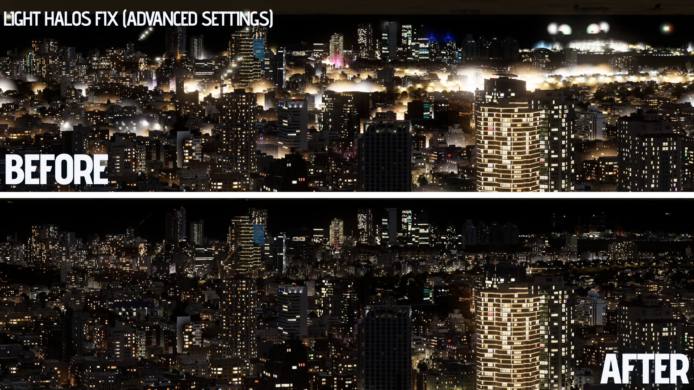

<div align="center">

# Volumetric Weather

**Volumetric clouds, weather and fog for Cities: Skylines.**

Real 3D clouds that cast shadows on your city, follow the game's weather, and bring their own
rain, lightning, rainbows and fog. Works on Windows, Mac and Linux.


[](https://store.steampowered.com/app/255710/Cities_Skylines/)
[](https://steamcommunity.com/sharedfiles/filedetails/?id=3805863507)
[](https://steamcommunity.com/sharedfiles/filedetails/?id=2040656402)


[](LICENSE)

[Features](#features) · [Getting started](#getting-started) · [Controls](#controls) · [Guide](#guide) · [Compatibility](#compatibility) · [How it works](#how-it-works) · [Building](#building) · [Changelog](CHANGELOG.md)

</div>

## Features

### Clouds

- Volumetric 3D clouds with real shadows on the ground and on buildings
- 5 cloud styles: Classic, Cumulus, Soft, Mixed and Auto
- Light inside the clouds, and sunsets that turn them orange and red
- Your own colors for the clouds' sunlit and shaded sides
- Distant clouds: photographed skies behind the mod's clouds (optional)
- Curved clouds that carry on down to the horizon (optional)

### Weather

- Follows the game's weather, or set it yourself
- Rain that falls from the clouds that are actually raining, with the rain sound and wet roads
  following the showers (snow on winter maps)
- Lightning, rainbows and waterspouts
- Volumetric fog that can change with the weather, lift in the morning, fill valleys and drift in
  from the sea (optional)
- Smaller light halos at night (optional)
- Trees that move in the wind (optional, experimental)

### Mod options

- Different values at sunset, at night and under an overcast sky
- Profiles for your favorite skies
- One key hides all of the weather while you build
- 4 panel looks
- English, Spanish, French and Simplified Chinese

<table>
  <tr>
    <td></td>
    <td></td>
  </tr>
  <tr>
    <td></td>
    <td></td>
  </tr>
</table>

## Getting started

1. **Subscribe** to [Harmony](https://steamcommunity.com/sharedfiles/filedetails/?id=2040656402)
   and then [this mod](https://steamcommunity.com/sharedfiles/filedetails/?id=3805863507), and make
   sure both are enabled. If you use Skyve, make sure the mod is enabled in it.
2. **Load a city** (new or saved) and the volumetric weather should appear. The mod doesn't run in
   the editors or in scenarios.
3. **Press F4** (or click the mod's button) to open the in-game panel.
4. **Press Shift+F4** to hide all of the weather while you build, and again to bring it back.

> [!TIP]
> To see more tabs in the panel, go to the mod's options (Pause menu → Options → Volumetric
> Weather) and tick **Show advanced options in the in-game panel**. The Weather and Halos tabs join
> the panel.

**Not using Steam?** Download the zip from [Releases](../../releases) and put its
`VolumetricClouds` folder (three DLLs) in `%LOCALAPPDATA%\Colossal Order\Cities_Skylines\Addons\Mods\`,
then enable the mod in Content Manager → Mods. You still need Harmony. Only use one copy: if you
subscribe later, remove the local one first.

## Controls

| Key | What it does |
| --- | --- |
| F4 | Opens or closes the panel |
| Shift+F4 | Hides all of the weather, press it again to bring it back. It isn't saved, so the weather is back the next time you load |

Both keys can be changed in the mod's options. On a Mac they're Fn+F4 and Fn+Shift+F4 on most
keyboards.

## Guide

The panel has five tabs: **Now**, **Clouds**, **Distant clouds**, **Fog** and **Light**, plus
**Weather** and **Halos** with the advanced options on. Every row has its own reset button. Some
rows also have a **clock** button, to give them a different value for the day, the sunset and the
night, or a **cloud** button, for a clear sky and a full overcast.

### Profiles

At the top of the panel. Save the whole sky under a name and switch skies from the list, or go
back to **(mod defaults)**. **Revert** undoes your changes since the last save. Each profile is a
plain XML file in the `VolumetricCloudsProfiles` folder (see [Files and logs](#files-and-logs)),
so they're easy to share. The Now tab isn't saved in profiles: picking one leaves the weather of
the moment as it is.

### Now

What the weather is doing right now, and your overrides.

| Setting | What it does |
| --- | --- |
| **Ignore the game's weather**, **Fixed intensity** | Set the cloud cover yourself instead of following the game's weather. |
| **Movement speed** | How fast the clouds drift. |
| **Wind direction** | **Follow the game**, **Follow the game slowly** (so the sky doesn't swing round every few minutes), or **Fixed**. |
| **Override the wind**, **Wind strength** | Set the city's wind by hand, from calm to a gale. These only show while something uses the wind: the trees, or another mod. |
| **Override fog**, **Fog amount** | Set the fog yourself. |
| **Override lightning**, **Lightning activity** | Set how much lightning there is. |
| **Rainbow chance**, **Waterspout chance** | How often you see them. A waterspout is a small funnel hanging from a cloud over the sea or near the shore, only to look at. |

### Clouds

| Setting | What it does |
| --- | --- |
| **Volumetric Weather** | Turns the mod's clouds on or off. |
| **Cloud style** | **Classic** (the default): an even, broken layer. **Cumulus**: heaped clouds with flat bases and billowing tops. **Soft**: fair-weather puffs with wispy edges. **Mixed**: all three at once, spread across the sky. **Auto**: follows the sky, from mostly puffs in fair weather to Cumulus under a heavy one. |
| **Classic layer**, **Cumulus size**, **Cumulus height**, **Cumulus amount** | The Cumulus heaps, and how much of the Classic layer stands among them. |
| **Cloud altitude**, **Layer thickness** | Where the clouds are, and how thick. |
| **Cloud detail**, **Break-up**, **Break-up detail** | From soft to sculpted, solid to ragged, big to fine. |
| **Cloud fragments**, **Fragment style** | Small shreds of cloud around and between the big ones: clustered, scattered or wispy. |
| **Sunlit side**, **Shaded side** | Tint each side, for warm tops over cool bases, a golden hour, or an orange city glow at night. Only the hue changes: white leaves the clouds as they are. |

### Distant clouds

Photographed skies behind the mod's own clouds, with cirrus, sheep clouds, cumulus on the horizon
and layered skies. They're lit by the game's sun, go gold at sunset, and drift and slowly change
with the wind. Off by default.

| Setting | What it does |
| --- | --- |
| **Dynamic distant clouds** | They come and go on their own, following the weather. |
| **Cirrus**, **Sheep clouds**, **Cumulus on the horizon**, **Mixed distant clouds** | Or set how much of each kind you want. |

### Fog

Off by default.

| Setting | What it does |
| --- | --- |
| **Volumetric fog** | Fog as a layer of its own, with a top surface, its own shadows and sun shafts. |
| **Fog follows the ground** | Draped over the terrain, instead of level from the sea. |
| **Fog fills valleys** | Fog that gathers in hollows and river gorges. |
| **Fog starts at**, **Fog height**, **Fog distance**, **Fog break-up**, **Fog speed** | Its shape and how it moves. |
| **Fog brightness**, **Fog tint**, **Fog color** | Its look. |
| **Dynamic fog** | **Fog changes with the weather**, **Morning fog** that lifts as the day warms up, **Mist after rain** rising from the wet ground, and **Fog over water**: fog banks drifting ashore from the sea, lakes and rivers. |
| **Fog lit by the city's lights**, **Lit fog brightness**, **Lit radius around a light** | At night the fog glows around street lamps, building lights and headlights. |

### Light

| Setting | What it does |
| --- | --- |
| **Clouds cast shadows on the ground**, **Shadow darkness**, **Shadow fullness** | The cloud shadows. The gaps between clouds get full sun, nothing is dimmed across the whole map. |
| **Cloud brightness**, **Cloud density** | How bright and how thick the clouds look. |
| **Glow and softer shade** | Thin cloud glows with the sun behind it, shaded sides are softer, and the sunlit city lights the cloud bases. |
| **Sunset light** | The clouds keep the low sun's light, turning orange and then red, a little after the sun has set for the city below. |
| **Clouds hide the sky** | Keeps a cubemap's sun from shining through a thick overcast. |
| **The fog's sunlight dims at full overcast to** | How much the fog's sunlight dims under a full overcast. |
| **Glow under the clouds at night** | A faint glow under the clouds at night. The clouds also hide the stars behind them. |

### Weather (advanced)

| Setting | What it does |
| --- | --- |
| **Intensity: clear weather**, **Intensity: rain** | How the game's weather sets the cloud cover. |
| **Weather pattern size**, **Larger weather pattern** | The cloud layout repeats four times further apart, for zooming far out with a camera mod (same cloud size). |
| **Curved clouds** | The cloud layer follows the curve of the Earth, so the clouds carry on down to the horizon (100% is the real Earth). Off by default. |
| **Cloud position X / Y** | Move this city's clouds around. Saved with the city. |
| **Replace the game's rain and snow** | Rain curtains hang under the clouds that are raining, and streaks fall near the camera, with their own length, width, brightness, color and speed. On winter maps the snow does the same. |
| **Rainbows** | An arch standing in a sunlit shower near where you look, with its fainter second bow. |
| **Rain sound, wet roads and road snow follow the clouds** | Instead of covering the whole map at once. |
| **Lightning lights the clouds and rain**, **Replace the game's lightning bolt** | Flashes light the clouds and rain from inside, and thunder arrives after the right delay for its distance. Storm lightning is only visual and never starts a fire. |
| **Trees move in the wind** | Experimental, off by default. Trees lean downwind and sway, gusts roll across forests, branches swing and leaves get thrown about in a storm, and torn-off leaves and dust blow around in a strong wind. The wind grows with cloud, rain and storms, or set it on the Now tab. Tree Control's sway settings still apply. |

### Halos (advanced)

| Setting | What it does |
| --- | --- |
| **Use the replacement light halos** | Smaller night halos on street and building lamps, and a fix for the game bug that turns a halo into a solid box. Off by default. |
| **Tightness**, **Brightness**, **Size** | The halos' look. |
| **Glare around near lamps** | A soft glow that hugs lamps close to the camera, with its size, distance, and whether it grows in fog and rain. |
| **Near lights** | Their own tightness, brightness and size for lamps close to the camera. |

### The mod's options

In the Pause menu → Options → Volumetric Weather:

- **Quality preset** (Low, Medium, High, the default, or Custom) sets the clouds', the fog's and
  the shadows' quality together. Custom gives you **Cloud and fog quality**, **Cloud shadow
  resolution**, **Cloud shadow updates** and **Buildings and terrain hide clouds behind them**.
- **Smoother clouds** blends frames together for less grain. It's on by default, and it's also the
  faster way to draw the clouds. If you notice smearing when the camera moves, untick it.
- **Simpler clouds for older graphics cards**: a lighter cloud shader, without the Soft and Mixed
  styles, curved clouds, smoother clouds, valley and water fog, or waterspouts. The mod switches to
  it by itself if the full clouds can't draw on your computer.
- The language, both keys, the advanced options, the **Panel look** (Frosted glass, See-through,
  Blue or Vanilla), **Where to show mod icon** (Unified UI, Toolbar or Never), **Detailed logging**,
  **Reset all settings to defaults** and **Reset cloud pattern**.

### Performance

*Classic* is the cheapest cloud style. *Cumulus*, *Soft*, *Mixed*, *Auto* and *Cloud detail* cost
more wherever there is cloud. A clear sky costs little, since the mod skips the parts of the sky
that can't hold any cloud. Volumetric fog is off by default. Macs have less graphics power to spare,
so expect a lower frame rate there than on a Windows PC.

## Compatibility

Tested together with **AD Cloud Replacer**, **Render It!**, **Theme Mixer**, **Play It!**, **Fog
Controller** and more, with no conflicts.

- **Render It!** and **Theme Mixer**: the mod never changes the sun's strength, and whatever Render
  It! sets for the game's fog comes back when the clouds are hidden.
- **Play It!**: its rain, fog and cloud sliders drive the sky.
- **AD Cloud Replacer** and other cloud replacers: the game's painted sky is left alone. Only its
  rain-cloud dome is switched off while these clouds show.
- **Intersection Marking Tool**: lamps placed as IMT props get the same halo settings as street
  lamps.
- **Tree Control**: its sway settings still apply to the trees' wind.
- **[Unified UI](https://steamcommunity.com/sharedfiles/filedetails/?id=2966990700)** (optional):
  the mod's button can go there. **Where to show mod icon** in the options picks Unified UI, the
  Toolbar or Never.

Everything the mod changes on the game's objects (the sun's light cookie, rain and lightning
materials, fog, halo materials, the stars' draw order) is put back when the city unloads.

**Platforms**: Windows (Direct3D 11, or OpenGL with `-force-glcore`), Mac (Metal) and native Linux
(OpenGL 3.3). Proton and the Steam Deck run the Windows version.

### Known issues / limitations

- **Mac and Linux get less testing**: I test on Windows and an Apple Silicon MacBook Air, and native
  Linux works but is less tested. If something looks wrong there, please let me know.
- **Older graphics cards**: the mod checks that its clouds really draw when a city loads. If they
  don't, it uses *Simpler clouds*, and if even those can't draw (they need shader model 4, Metal or
  OpenGL 3.3), it switches itself off and tells you, leaving the city as it is.
- **Cloud shadows come from the sun only**, not the moon.
- **100% intensity is a heavy overcast, not a sealed one**: some patches of sun stay, on purpose.
- **Other cameras draw the clouds too**, like the ones the game or other mods use for reflections.

### Saves

Each city keeps a small record of its sky in the savegame (77 bytes under the mod's own key: the
cloud pattern, how far the wind has carried it, and where you moved the clouds), so a city looks
the same when you come back. None of the game's own data is changed, and **removing the mod
shouldn't corrupt your saves**: they still load without it. The mod is provided as is, so keep
backups of the cities you care about.

### Files and logs

Everything is in the game's data folder:

| Windows | Mac | Linux |
| --- | --- | --- |
| `%LOCALAPPDATA%\Colossal Order\Cities_Skylines` | `~/Library/Application Support/Colossal Order/Cities_Skylines` | `~/.local/share/Colossal Order/Cities_Skylines` |

| File | |
| --- | --- |
| `VolumetricClouds.log` | The mod's log, started fresh at every launch. |
| `VolumetricClouds.xml` | Your settings. |
| `VolumetricCloudsProfiles` | Your profiles, one XML file each. |

### Reporting a bug

Please [open an issue](../../issues) and include the following:

1. **The game's log**, `output_log.txt`. In Steam, right-click Cities: Skylines → Manage → Browse
   local files, then open the `Cities_Data` folder. On a Mac it's `~/Library/Logs/Unity/Player.log`,
   on Linux `~/.config/unity3d/Colossal Order/Cities_Skylines/Player.log`.
2. **The mod's own log**, `VolumetricClouds.log`. Tick **Detailed logging** (Options → Volumetric
   Weather) first, then make the problem happen again.
3. **What happened**: what you did and expected, screenshots, your graphics card and your other
   mods.

Both logs start fresh at every launch, so copy them before restarting the game.

### Translations

Every text the mod shows is in
[`VolumetricClouds/Localization/en.xml`](VolumetricClouds/Localization/en.xml), with Spanish
(`es.xml`), French (`fr.xml`) and Simplified Chinese (`zh.xml`) beside it. To add a language, copy
`en.xml` under the game's code for it (`de.xml`, `pt.xml`...) and translate the text between the
tags. The comment at the top explains the rest. Anything not translated yet shows in English.
Corrections from native speakers are welcome.

## How it works

Volumetric Weather is written from scratch, but it builds on published techniques. The sources are
credited in the notes at the bottom of the page. Click a topic to read more.

<details>
<summary><b>The clouds</b>: one shape for the clouds and their shadows</summary>

<br>

- When a city loads, the mod makes its noise off the main thread: a tiling Perlin-Worley weather
  map (where the clouds are) and tiling 3D noise (their shape, billows and erosion).[^schneider]
- One function defines the whole cloud volume. The pass that draws the clouds and the pass that
  makes their shadows both step through it, so the clouds and their shadows always match.
- Cloud detail and the Cumulus style follow EVE-Redux's clouds: their noise, their coverage,
  erosion and edge hardness, and the curve that sets how much cumulus there is.[^eve]

</details>

<details>
<summary><b>Light in the clouds</b>: glow, soft shade and sunsets</summary>

<br>

- Light inside the clouds uses four phase lobes (how much light bounces each way) and several
  scattering octaves, so light carries on deep inside thick clouds, like in real ones.[^eve][^scatter]
- The rays through the clouds start at blue-noise offsets, which turns banding into fine grain.
  *Smoother clouds* blends frames together to smooth that grain away.[^ulichney]

</details>

<details>
<summary><b>Shadows</b>: one texture for the sun</summary>

<br>

A 2048 × 2048 texture sends one sun ray through the clouds for each of its pixels, and becomes the
sun's light cookie (a mask on the sun's light). It's the only thing that darkens the world, so the
gaps between clouds get full sun.

</details>

<details>
<summary><b>Cloud cover</b>: worked out, not guessed</summary>

<br>

The threshold that cuts clouds out of the weather map is solved against that map's histogram, so a
cover setting really means that share of the sky.[^acklam] Rain uses the same table with a higher
threshold, so it can only fall from clouds.

</details>

<details>
<summary><b>The game's weather</b>: read, never written</summary>

<br>

The mod never changes the game's weather. Its one change to the simulation is a small Harmony
patch on `WeatherManager.SampleRainIntensity`, so the rain sound, wet roads and road snow follow the
clouds.

</details>

<details>
<summary><b>Rain, lightning, fog and rainbows</b>: drawn with the clouds</summary>

<br>

They share the cloud pass and are blended front to back. The fog is lit through the cloud shadows,
which is where the sun shafts come from. The rainbow is an arch fixed in the world, colored by the
physics of light in real raindrops.[^airy]

</details>

<details>
<summary><b>Halos</b>: a shader swap</summary>

<br>

The replacement halos are drawn by ports of the game's own halo shader, swapped into the game's
light layers. The game's own materials are never modified.

</details>

<details>
<summary><b>Trees</b>: a shader swap too</summary>

<br>

- The game's two tree shaders are rebuilt from their compiled code, checked program by program
  against the game's own, put on the game's tree materials and given back afterwards. Only their
  movement differs.
- Each tree bends about its base instead of shearing, and sways on three rates that never line up.
  A gust field drifts downwind, and branches and leaves each move on their own, weighted by the
  game's own sway mask.[^sousa][^pcg]

</details>

<details>
<summary><b>One wind for the city</b>: other mods can read it</summary>

<br>

The city's wind (its strength from the weather or the Now tab, its direction and its gusts) is one
wind, which the trees follow and other mods can read: `VolumetricClouds.Sky.WeatherWind`, with
`Ready`, `Direction`, `Speed` (m/s at 10 m), `Gusts`, `SpeedAt(x, z)`, `GustAt(x, z)` and
`Overridden` (`ApiVersion` 1). It only runs while the trees' wind is on or another mod has read
`Ready` in that city.

</details>

## Building

See [BUILDING.md](BUILDING.md) for the details. In short, clone with `--recurse-submodules` (the
panel's controls come from the ModsLibCS1 submodule), then:

```powershell
.\build-bundle.ps1                                      # only after changing a shader: compiles it with Unity 5.6.6
dotnet build VolumetricClouds/VolumetricClouds.csproj   # builds the mod and deploys it to the game's Mods folder
```

The compiled shaders are in the repo, so a normal build only needs the second line.
`build-bundle.ps1` builds the Windows shaders, and `-All` adds Mac and Linux. The pure logic is
tested offline by `tools/test-*.ps1`, and the rest is checked in the game through the mod's log.

## Credits

<sub>

Volumetric Weather is written from scratch, but it builds on published techniques, all credited in
the notes below (no code from them is included). The distant clouds' photographed skies are from
[Poly Haven](https://polyhaven.com) (CC0). The panel's icons are based on
[Lucide](https://lucide.dev)'s (ISC). Includes UnifiedUILib by kianzarrin and CitiesHarmony.API by
boformer, thanks to both. Other mods were read to stay compatible with them, without using any of
their code. Full license info is in [THIRD-PARTY-NOTICES.md](THIRD-PARTY-NOTICES.md).

This mod was made with substantial help from AI. I set the goals, made the design decisions, and
did all of the in-game testing and tuning.

</sub>

## License

The source is under the [MIT License](LICENSE), copyright © 2026 Anthony Ibrahim, except for two
kinds of file made for compatibility with the game: the halo shaders (`LightHalo.shader`,
`LightHaloDynamic.shader` and a few lines of `FogLamps.shader`), ports of the game's own halo
shader, and the parts of the tree shaders (`Trees*.shader`, `TreesDefault.cginc`,
`TreesGroup.cginc`) rebuilt from the game's own tree shaders. Those are the work of Colossal Order
Ltd., see [THIRD-PARTY-NOTICES.md](THIRD-PARTY-NOTICES.md).

<sub>

Cities: Skylines is © Colossal Order Ltd., published by Paradox Interactive AB. Unity is a
trademark of Unity Technologies. This is an unofficial fan-made mod, not affiliated with or
endorsed by either. Apart from the ported shader code, this repository holds no game code or
assets: the game's DLLs are referenced from your own installation and never copied.

</sub>

[^schneider]: **The clouds.** A. Schneider (Guerrilla Games), *The Real-Time Volumetric Cloudscapes of Horizon Zero Dawn* (SIGGRAPH 2015): Perlin-Worley noise, remap-based shaping and erosion, and a weather map controlling the coverage.
[^eve]: **Cloud detail, Cumulus and the lighting.** EVE-Redux, blackrack's volumetric clouds for Kerbal Space Program ([LGhassen/EnvironmentalVisualEnhancements](https://github.com/LGhassen/EnvironmentalVisualEnhancements), MIT): its "spherical" Worley noise and that noise's default octaves, its coverage, erosion and edge-hardness model, the four phase lobes of its lighting, and the cumulus coverage curve of an Earth-like configuration (Promised Worlds' Gurdamma). Read from its public C# code, wiki and configurations; EVE-Redux's shaders are not public and were not used.
[^scatter]: **Multiple scattering.** M. Wrenninge, *Oz: The Great and Volumetric* (SIGGRAPH 2013), as presented by S. Hillaire, *Physically Based Sky, Atmosphere and Cloud Rendering in Frostbite* (SIGGRAPH 2016): the scattering octaves.
[^ulichney]: **Blue noise.** R. Ulichney, *The void-and-cluster method for dither array generation* (SPIE 1993): the rays' jitter.
[^acklam]: **Cloud cover.** P. Acklam's rational approximation of the normal quantile: the weather map's normal scores.
[^airy]: **The rainbow.** G. B. Airy's theory of the rainbow (1838), per wavelength and drop size.
[^sousa]: **The trees' bend.** T. Sousa, *Vegetation Procedural Animation and Shading in Crysis* (GPU Gems 3, ch. 16, 2007): the main bending about each tree's base, and from its detail bending the branches' own swing and the leaves' flutter, weighted by a per-vertex mask, and the sway as a sum of waves at rates that don't line up.
[^pcg]: **The gusts, leaves and dust.** M. Jarzynski and M. Olano, *Hash Functions for GPU Rendering* (Journal of Computer Graphics Techniques, 2020): pcg2d for the gust field's noise, pcg4d for the leaves' and the dust's random numbers.
